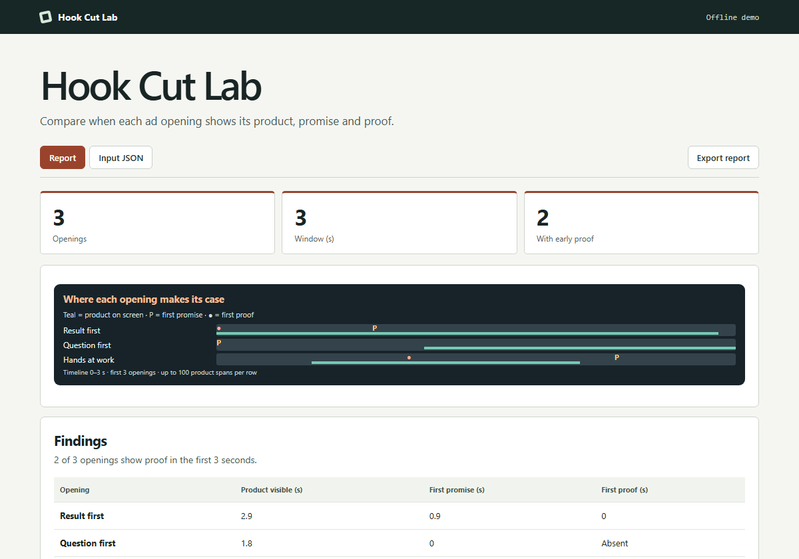

# Hook Cut Lab

Compare when each ad opening shows its product, promise and proof.



[Deploy to Render](https://render.com/deploy?repo=https://github.com/oguzhanozfe/hook-cut-lab) · [Example input](example.json) · [Computed report](docs/example-report.json) · [Model settings](#connect-a-model)

## Try it

With Python 3.11 or newer, run:

```sh
git clone https://github.com/oguzhanozfe/hook-cut-lab.git
cd hook-cut-lab
python app.py
```

Open **http://127.0.0.1:8000**. The example is already loaded. Choose **Input JSON** to edit it or open your own file, then **Run analysis**. **Export report** saves the computed evidence as JSON. The example works on a CPU with no dependencies, accounts or API keys.

## What the example shows

Three cuts can share a script and still make very different first impressions. Hook Cut Lab compares what an editor actually placed inside the same opening window. In the example, one cut leads with the finished result, a second asks a question, and a third shows the work before revealing proof.

Label the intervals in each variant with one or more of `product`, `promise`, `proof`, `context` and `title`. Use seconds relative to the start of that cut. The default comparison window is three seconds. Intervals are clipped at its end. Overlapping product tags count only once, so stacked text and footage annotations cannot inflate visibility. Promise and proof are reported by their first appearance. A beat that begins exactly at the cutoff belongs to the next window.

Use the table to choose the timing difference worth testing while holding the rest of the ad constant. Exposure and appearance times describe an edit; conversion or viewer retention requires observed campaign data.

**Sample result:** 2 of 3 openings show proof in the first 3 seconds.

## Run without a browser

```sh
python app.py analyze example.json
python -m unittest discover -v
```

The CLI writes JSON to stdout. The HTTP interface accepts `POST /api/analyze` with content type `application/json` and body `{"input": {...}, "review": false}`. The input object has the same shape as [example.json](example.json). `GET /api/example` returns a complete working request input and report. `GET /health` is the deployment health check.

## Connect a model

Analysis always computes the measurements locally. To add an English review of those measurements, select a provider on the **server**, set its variables and restart. `MODEL_PROVIDER=off` is the default.

| Provider | Configuration |
| --- | --- |
| Local (Ollama, LM Studio, llama.cpp) | `MODEL_PROVIDER=local`, `MODEL_ID=<installed chat model>`, `MODEL_BASE_URL=http://127.0.0.1:11434/v1` (Ollama) or `http://127.0.0.1:1234/v1` (LM Studio). |
| Azure OpenAI | `MODEL_PROVIDER=azure`, `MODEL_ID=<deployment name>`, `MODEL_BASE_URL=https://<resource>.openai.azure.com/openai/v1`, `MODEL_API_KEY=<resource key>`. |
| AWS Bedrock | `MODEL_PROVIDER=bedrock`, `MODEL_ID=<Converse-compatible model or inference profile ID>`, `AWS_REGION=<region>`. Use an AWS role or the standard SDK credential chain with permission to invoke that model. Install `requirements.txt` when running outside Docker. |
| OpenAI or compatible hosted API | `MODEL_PROVIDER=api`, `MODEL_BASE_URL=https://<provider>/v1`, `MODEL_ID=<chat model>`, `MODEL_API_KEY=<key>`. The default API root is `https://api.openai.com/v1`. |

For example, with a running local model (Bash):

```sh
MODEL_PROVIDER=local MODEL_ID=your-model MODEL_BASE_URL=http://127.0.0.1:1234/v1 python app.py analyze example.json --review
```

On PowerShell set each variable with `$env:MODEL_ID = "your-model"` (and likewise for the provider and base URL) before running `python app.py analyze example.json --review`. Model output is a separate `model_review` field. The model receives the summary, metrics and a bounded sample of result rows. An optional review with a hosted provider sends that evidence to the configured provider.

## Deploy

The Render link uses [render.yaml](render.yaml) to deploy the included Dockerfile. Select the new service and deploy. An account is required on the hosting platform. To run the same container locally:

```sh
docker build -t hook-cut-lab .
docker run --rm -p 127.0.0.1:8000:8000 hook-cut-lab
```

The container honors `PORT` (default 8000). Add provider variables through the host's secret settings or Docker's `--env-file`. For browser model reviews on a deployment, also set a long `MODEL_ACCESS_TOKEN` and enter it in **Model review**. The server keeps provider credentials out of the browser. To reach a model on the Docker host, use a reachable host address instead of container loopback; Docker Desktop provides `host.docker.internal`.

The deterministic analysis lives in [project.py](project.py). Provider adapters are in [providers.py](providers.py). [MIT license](LICENSE).
